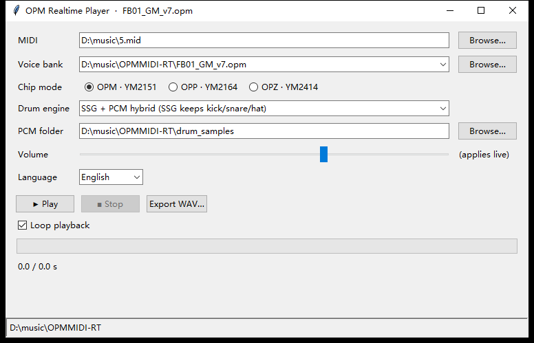

# OPM Realtime Player

> **Language**: [English | [简体中文](README_zh.md)]

Realtime MIDI player for the **Yamaha YM2151 (OPM)**, built on the cycle-accurate
[Nuked OPM](https://github.com/nukeykt/Nuked-OPM) core — with a hybrid
**FM + SSG + PCM** engine, a tkinter GUI, a CLI, and a single-file Windows EXE.

Ships with GM voice banks for OPM/OPP, plays standard MIDI files, and can drive
three different drum engines: synthesized FM drums, YM2149 (SSG) percussion, or
sampled drums (bring your own samples).

**License: MIT** (code) · third-party components under their own terms — see [NOTICE.md](NOTICE.md).
For personal study and retro-tech research.



> **⬇️ Download**: the prebuilt single-file EXE is attached to the
> [**Releases**](../../releases) page (~25 MB, no Python required).
>
> The repository ships **source only** — `dist/` is gitignored on purpose. The EXE is
> fully reproducible with `build_exe.ps1`; see [BUILD.md](BUILD.md).

```
python app.py                      # GUI
python rtplayer.py song.mid --ssg  # CLI
```

---

## Origin & scope

The realtime engine, the SSG/PCM sound sources, the GUI and the EXE packaging all
grew out of the author's **offline OPMMIDI renderer** (the `player.py` MIDI → WAV
pipeline).

But the additions — sample-accurate realtime scheduling, a producer thread,
resampling, three drum engines, a GUI, build scripts and a whole voice-bank
toolchain — have long outgrown "a branch of an offline renderer". So the realtime
version lives in **its own repository** (this one), keeping the offline project
focused.

| | Offline OPMMIDI | This repo (realtime) |
|---|---|---|
| Purpose | batch MIDI → WAV | realtime playback + export |
| Sources | single FM chip (8 ch) | FM + SSG + PCM hybrid |
| Timing | dispatch at block boundaries | sample-accurate, block-size independent |
| Extras | VGM export, WOPN interop | GUI, single-file EXE, loop, live mixing |
| Relation | upstream, maintained separately | forked from it, now independent |

`player.py` / `translator.py` / `smf.py` are kept here mainly as a **regression
baseline**: the realtime engine must match the offline renderer bit-for-bit
(`tool/rt_selftest.py` checks exactly that).

## Features

| | |
|---|---|
| **Chip modes** | OPM (YM2151) · OPP (YM2164) · OPZ (YM2414) |
| **Drum engines** | FM (hard-coded bank) · SSG (YM2149) · SSG corrected · PCM samples |
| **Voice banks** | any VOPM `.opm` file; GM banks ship with the repo |
| **Latency** | 22 ms measured (WASAPI shared, 256-frame blocks) |
| **Export** | WAV out through the *same* render chain (48 kHz, or native 55 930 Hz) |
| **Loop** | checkbox in the GUI, `--loop` on the CLI |
| **Realtime headroom** | OPM core runs at ~3.1× realtime; producer thread at ~2.2× |
| **EXE** | single file, ~25 MB, no installer, no Python required |
| **UI languages** | Chinese / English, switchable at runtime |

---

## Quick start

### Prebuilt EXE

```
OPMMIDI-RT.exe
```

Put any `.opm` voice bank next to the EXE and pick it in the dropdown.
Run `OPMMIDI-RT.exe --selfcheck` to write a diagnostics log to `selfcheck.log`.

### From source

```powershell
git clone <this repo> OPMMIDI-RT
cd OPMMIDI-RT
python -m pip install -r requirements.txt
python app.py
```

Requires Python 3.10+ (tested on 3.14.7). Only two dependencies: `numpy`, `sounddevice`.
The native cores (`opm.dll`, `ssg.dll`) are prebuilt and included — no compiler needed.

### Build the EXE yourself

```powershell
python -m pip install pyinstaller
.\build_exe.ps1
```

Full instructions, troubleshooting table, and the exact PyInstaller flags:
**[BUILD.md](BUILD.md)**.

---

## Drum engines

YM2151 has no sample playback, so percussion is the interesting part. Four options:

| Mode | What it does |
|---|---|
| `fm` | FM drums synthesized from a hard-coded parameter table (`DRUM_BANK`) |
| `ssg` | Kick / snare / hi-hat rendered on a YM2149 (3 tone + noise), GAI2 recipe |
| `ssg-clean` | Same, with corrected mixer bits (real noise snare / hi-hat) |
| `pcm` | Sampled drums from a folder you specify |
| `ssg+pcm` | Hybrid: SSG takes kick/snare/hat, PCM takes the rest |
| `ssg-clean+pcm` | Hybrid with the corrected SSG recipe |

The SSG engines use the chip's **hardware envelope** for decay, and don't consume
any OPM channel — SSG drums and PCM drums both bypass the FM voice allocator entirely.

> **A note on `ssg` vs `ssg-clean`:** the original GAI2 recipe writes R7 with an
> inverted interpretation, so the "kick" is actually noise, the "snare" is a DC
> envelope step, and the "hi-hat" is a single tone. It still *sounds* punchy because
> those are hand-tuned. `ssg-clean` uses the canonical bits (`0x3E / 0x2D / 0x1B`) —
> punchier transients, weaker body. Both are kept; try both.

### PCM samples are not included

Drum samples are **audio recordings** with their own copyright (the reference set is
Korg M1). Neither the repo nor the EXE contains any. Supply your own folder:

```
drum_samples\
    M01 01 Kick 1.wav
    M01 04 Snare 1.wav
    M01 11 Closed HH1.wav
    M01 15 Crash.wav
    ...
```

#### Naming rules

A file just has to **contain** one of the keywords below (case and spacing are
ignored). One sample registers onto *every* matching note, so ~20 files cover an
entire GM drum kit.

| GM note | Instrument | Keyword |
|---|---|---|
| 35 / 36 | Kick | `Kick 1` / `Kick 2` |
| 38 / 40 | Snare | `Snare 1` / `Snare 2` |
| 39 | Hand clap | `Claps` |
| 42 / 44 / 46 | Hi-hat | `Closed HH` / `Closed HH 2` / `Open HH` |
| 41 / 45 / 48 / 50 | Toms | `Tom 2` / `Tom 1` |
| 43 / 47 | Electronic tom | `E.Tom` |
| 49 / 52 / 55 / 57 | Crash | `Crash` |
| 51 / 59 | Ride | `Ride` |
| 53 | Ride bell | `Bell Ring` |
| 54 | Tambourine | `Tambourine` |
| 56 | Cowbell | `Cowbell` |
| 58 | Vibra slap | `Vibe Hit` |
| 60 / 62 / 63 | Conga | `Conga 1` |
| 61 / 64 | Low conga | `Conga 2` |
| 65 / 66 | Timbales | `Timbales 1` / `Timbales 2` |
| 69 / 70 | Shaker | `Shaker` |
| 75 / 76 / 77 | Woodblock | `Block` |
| 80 / 81 | Tubular / triangle | `Tubular` |
| 82 | Whip | `Whip` |

#### Where to get samples: KORG M1 waveforms

The author uses **KORG M1 drum waveforms** — the
**"KORG M1 Waveforms Soundfont"** compiled by PlaceboPerson1, published on
**Musical Artifacts** (search for **Artifact #9388**).

1. **Download**: Musical Artifacts → Artifact #9388 (the page needs a manual click).
   The archive contains standalone drum WAV files.
2. **Extract**: drop the WAVs into `drum_samples/`
3. **Process (recommended)**: `python tool/process_drums.py`
   — 22 kHz downsample + 4.5 kHz low-pass + 8-bit bitcrush, output to `drum_samples/lofi/`
4. **Play**: point **PCM folder** at `drum_samples/lofi/`
   (the loader scans one level only, it does not recurse)

The `M01 01 Kick 1.wav` naming comes straight from the M1 patch schema
(`M01` is the bank number).

You do not have to use an M1: **matching is by filename only**, so any drum machine
or sample pack single hits work after renaming — the result depends on how much the
sample resembles the intended instrument. Your own recordings work too.

> **⚠️ Legal notice**: this repository **distributes no KORG samples**. The source
> above is for educational and preservation purposes only; commercial use is
> prohibited, obtain samples legally yourself. PCM drums are entirely optional —
> without samples the player falls back to SSG / FM synthesized drums.

#### Optional: the lo-fi treatment

The GAI version shipped a small pipeline (`drum_samples/process_drums.py`) that
degrades samples to 22 kHz, kills everything above 4.5 kHz and crushes them to
8-bit for extra grit:

```bash
ffmpeg -i in.wav -ar 22050 \
  -af "lowpass=f=4500, acrusher=bits=8:mode=log:aa=1" \
  -c:a pcm_s16le out.wav
```

Processed this way the kit lands much closer to X68000 / PC-98 era PCM, and stacks
nicely with `--pcm-lofi` (12-bit crush + low-pass) on top.

#### Where to put them

- GUI: point **PCM folder** at the directory
- CLI: `--drum-dir "D:\...\drum_samples"`
- Default: the player looks for `drum_samples/` next to the EXE or `app.py`

Any sample rate works (resampled to 55 930 Hz on load). Mono and stereo are both
accepted (stereo is downmixed).

#### If you have no samples

Selecting PCM drums with an invalid folder shows a warning; the player **never
crashes** — it falls back to SSG / FM synthesized drums. So the app is fully usable
without any sample material, just with synthesized percussion.

---

## Chip modes

| Mode | Chip | Notes |
|---|---|---|
| `opm` | YM2151 | 8 channels, the default |
| `opp` | YM2164 | OPP variant: TL ramp + different timer B divider + test register at `0x09` |
| `opz` | YM2414 | OPZ variant: no LFO generator, no CSM — those registers are dropped |

OPP and OPZ are handled inside the Nuked OPM core (`chip->opp` paths), not by
parameter translation, so percussion and envelope behavior differ per chip.

---

## Voice banks

The repo ships `.opm` banks built from their author's own dumps and conversions:

| Bank | Content |
|---|---|
| `FB01_GM_v7.opm` | **recommended**. 128 GM slots: FB-01 (OPP) 71 + TX81Z (OPZ) 38 + X68K/MDX 18 + arcade 1 |
| `FB01_GM_v4.opm` | 128 GM slots, pure OPP+OPZ (no X68K) — more consistent general-purpose set |
| `NECOPN_GM.opm` | extracted from a reverse-engineered `NECOPN.DRV` |
| `xg.opm`, `FMTowns.opm`, `mp_fm.opm`, `fmmidi.opm` | community OPM presets |
| `legacy/FB01_GM_original.opm` | first iteration, superseded by v7; **not scanned by the GUI**, kept for A/B |

`.opm` is a plain-text register-parameter format — no audio content. Banks are
shipped; see **[NOTICE.md](NOTICE.md)** for provenance and licensing.

Program numbers map positionally: **MIDI program N → voice N** in the bank
(0-based), which matches GM for the first 128 entries.

---

## Export & loop

**Export** renders through the *same* chain as playback — chip mode, drum engine,
mixing, DC blocker and resampling all apply — so the WAV sounds exactly like what
you heard.

```powershell
# GUI: click "Export WAV…"
python rtplayer.py song.mid --export out.wav --ssg --pcm   # 48 kHz, same as playback
python rtplayer.py song.mid --export raw.wav --export-sr 55930   # chip-native, no resampling
```

`--export-sr 55930` skips the resampler — useful if you want to post-process or
analyse the raw chip output. Rendering runs at ~3× realtime, in a background
thread, with a progress bar and cancel.

**Loop** restarts playback from the top when the song ends: tick the checkbox in the
GUI, or pass `--loop` on the CLI. Each pass rebuilds the chip and replays program
changes, CCs and pitch bends up to the start, then re-keys any note still held —
the OPM is a stateful chip, so a truly gapless loop would require a different
renderer architecture.

## How it works

```
MIDI ── parse_smf ──► events (seconds)
                        │
                        ▼
                 Renderer: sample-accurate event splitter
                        │            • events land on exact sample frames
                        ▼            • block-size independent output
        ┌───────────────┼───────────────┐
        ▼               ▼               ▼
   OpmCore          SsgCore          PcmCore
  (48 kHz out)     (55 930 Hz)      (55 930 Hz)
        └───────────────┼───────────────┘
                        ▼
              float32 mix + DC blocker + clip
                        ▼
              Resampler 55 930 → 48 000 (4-point Catmull-Rom)
                        ▼
              Producer thread ──► ring buffer ──► sounddevice callback
```

Key design points:

- **Sample-accurate scheduling.** The offline renderer dispatches events at block
  boundaries (≈4.5 ms average, 9 ms worst case late). The realtime engine splits
  blocks at event frames instead — measured 310/310 events on exact samples, and
  output is bit-identical regardless of block size.
- **DC blocker on the SSG bus.** Real YM2149 output is AC-coupled; a DC envelope
  step becomes a click. Without it the "snare" spends 43 % of its peak on DC offset.
- **Resampling, not clock scaling.** The chip stays at 3.579545 MHz (55 930 Hz)
  so tuning is exact; output is resampled to 48 kHz because most devices refuse
  55 930 Hz.
- **MDX voices need LFO reset.** `mdx2opm` copies the song-global LFO into every
  voice block (measured 6 732/6 732 as `LFO: 128 64 64`). Imported banks normalize it.

---

## Measured performance

| Metric | Value |
|---|---|
| OPM core throughput | 3.15× realtime (gcc `-O2`: 3.50×, timer-stripped: 4.10×) |
| Producer thread (with resampling) | 2.19× realtime |
| SSG core cost | 7.5 ms per audio-second (0.1 % of OPM) |
| Playback latency | 22 ms @ 256-frame blocks, WASAPI shared |
| Underruns in tests | 0 (3 consecutive runs, drum-heavy track) |

Recompiling notes: `-O2` beats `-O3` (3.50× vs 3.20×) — the core is per-clock scalar
code, and aggressive optimization hurts locality.

---

## Repository layout

| File | Role |
|---|---|
| `app.py` | tkinter GUI (zh/en), `--selfcheck` diagnostics |
| `rtplayer.py` | CLI player |
| `player_session.py` | assembles core + bank + drums + engine; shared by GUI and EXE |
| `rt_engine.py` | realtime engine: event splitter, resampler, producer thread, mixer |
| `core.py` / `ssg_core.py` / `pcm_core.py` | ctypes bindings and PCM voice engine |
| `driver.py` | OPM register driver: voice allocation, voice loading, drum routing |
| `smf.py` / `voice.py` / `translator.py` | MIDI parsing, `.opm` parsing, OPN→OPM translation |
| `player.py` | offline MIDI→WAV renderer (reference implementation for regression) |
| `core/` | Nuked OPM (LGPL-2.1) and emu2149 (MIT) sources |
| `tool/` | bank inspection, acoustic audit, pool scanning, bank builder |
| `build_exe.ps1` | one-command EXE build |

---

## FAQ

**No sound?**
1. Make sure the chip mode is `opm` / `opp` (`opz` drops LFO registers, but is not silent)
2. Make sure the voice bank path is valid and non-empty
3. Watch `underrun` in the status bar — if it stays 0, audio is flowing and the problem
   is system volume or the output device

**`underrun` keeps climbing?**
Raise the block size from 256 to 512. The OPM core runs at ~3× realtime; if another
program saturates the core you will underrun. No GUI option for it — use
`rtplayer.py ... --blocksize 512`.

**PCM drums are silent?**
Check that the PCM folder contains `.wav` files whose names carry one of the keywords
above. The status bar shows a count like `PCM 39`; zero means nothing was loaded.
Note that an invalid folder silently falls back to SSG/FM drums — "it plays but does
not sound sampled" has the same cause.

**Strings stopped wobbling after switching to OPZ?**
The YM2414 has no LFO generator; `--chip opz` discards LFO/CSM registers. Chip
behavior, not a bug.

**Why do dense passages drop notes?**
The YM2151 has 8 physical channels. FM drums occupy one, leaving 7 for melody; when
drums go to SSG/PCM the 8th returns to melody. That limit is the hardware, and the
upstream voice-stealing algorithm exists to emulate it.

**Antivirus flags the EXE?**
Common PyInstaller one-file false positive. Options: code-sign it, or switch
`build_exe.ps1` to `--onedir`.

## Testing

```powershell
python tool\rt_selftest.py --midi song.mid --limit 8   # 19 engine checks, no sound card
python tool\smoke_test.py                              # core makes sound → smoke.wav
OPMMIDI-RT.exe --selfcheck                             # frozen-bundle diagnostics
```

The self-test covers: bit-exact agreement with the offline renderer, event-frame
accuracy, block-size independence, resampler invariants, producer throughput, and
SSG/PCM routing.

---

## License

**MIT** — see [LICENSE](LICENSE). Third-party components keep their own terms:

- **Nuked OPM** (`core/opm*.c`): LGPL-2.1, © Nuke.YKT. Loaded as a separate
  `opm.dll` so relinking stays possible.
- **emu2149** (`core/emu2149-main/`): MIT, © Mitsutaka Okazaki.
- **Voice banks**: dumped/converted by the author; see [NOTICE.md](NOTICE.md).

## Credits

- [Nuked-OPM](https://github.com/nukeykt/Nuked-OPM) — Nuke.YKT
- [emu2149](https://github.com/mitsutakaokazaki/emu2149) — Mitsutaka Okazaki
- Wohlstand / JP Cimalando for OPN2-BE's OPM export support and the WOPN library work
- [mdxtools](https://github.com/vampirefrog/mdxtools) — `mdx2opm`
- Voice banks extracted from [necopn-drv-reverse](https://github.com/EriczjrWinter/necopn-drv-reverse)
- The realtime engine grew out of the author's offline OPM MIDI renderer
