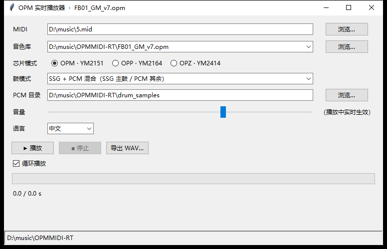

# OPM 实时播放器

> **语言**：[[English](README.md) | 简体中文]

基于周期精确的 [Nuked OPM](https://github.com/nukeykt/Nuked-OPM) 核心，
为 **Yamaha YM2151 (OPM)** 打造的实时 MIDI 播放器——带 **FM + SSG + PCM**
混合音源、tkinter 图形界面、命令行界面，以及单文件 Windows EXE。

随仓库附带 OPM/OPP 的 GM 音色库，可直接播放标准 MIDI 文件；打击乐有三种引擎可选：
FM 合成鼓、YM2149 (SSG) 打击乐、采样鼓（采样需自备）。

**许可证：MIT**（代码部分）· 第三方组件遵循各自许可证，见 [NOTICE.md](NOTICE.md)。
本项目仅供个人学习、复古技术研究与交流，所有权利归各自所有者所有。



> **⬇️ 下载**：打包好的单文件 EXE 挂在 [**Releases**](../../releases) 页（约 25 MB，无需 Python）。
>
> 仓库里**只放源码**——`dist/` 是故意 gitignore 掉的。EXE 用 `build_exe.ps1` 可以完整复现，
> 见 [BUILD.md](BUILD.md)。

```
python app.py                      # 图形界面
python rtplayer.py song.mid --ssg  # 命令行
```

---

## 由来与定位

本项目的实时引擎、SSG/PCM 音源、图形界面和 EXE 打包，都是从作者的**离线版
OPMMIDI**（`player.py` 那套 MIDI → WAV 渲染器）生长出来的。

但随着新增内容越来越多——采样级实时调度、生产者线程、重采样、三种鼓引擎、
GUI、打包脚本、一整套音色库工具链——它已经远超"离线渲染器的一个分支"的范围。
为了不让主干仓库被这些内容撑变形，**实时版单独开了一个仓库，就是这里**。

| | 离线版 OPMMIDI | 本仓库（实时版） |
|---|---|---|
| 定位 | MIDI → WAV 批处理 | 实时播放 + 导出 |
| 音源 | FM 单芯片（8 通道） | FM + SSG + PCM 混合 |
| 调度 | 块边界派发 | 采样级，块大小无关 |
| 附加 | VGM 导出、WOPN 互操作 | GUI、单文件 EXE、循环、实时混音 |
| 关系 | 主干，独立维护 | 从它分叉，现已独立演进 |

`player.py` / `translator.py` / `smf.py` 等文件在这里保留，主要作为**回归基准**：
实时引擎的输出要和离线渲染逐字节对得上（`tool/rt_selftest.py` 会检查这一条）。

## 特性

| | |
|---|---|
| **芯片模式** | OPM (YM2151) · OPP (YM2164) · OPZ (YM2414) |
| **鼓引擎** | FM（硬编码鼓组）· SSG (YM2149) · SSG 修正配方 · PCM 采样 |
| **音色库** | 任意 VOPM `.opm`；仓库附带 GM 库 |
| **延迟** | 实测 22 ms（WASAPI 共享模式，256 帧块） |
| **导出** | 走**同一条**渲染链输出 WAV（48 kHz，或 55 930 Hz 芯片原生） |
| **循环** | 界面勾选框，或命令行 `--loop` |
| **实时余量** | OPM 核心约 3.1 倍实时；生产者线程约 2.2 倍 |
| **EXE** | 单文件约 25 MB，无需安装、无需 Python |
| **界面语言** | 中文 / English，运行时可切换 |

---

## 快速开始

### 现成 EXE

```
OPMMIDI-RT.exe
```

把任意 `.opm` 音色库放在 EXE 旁边，在下拉框里选它即可。
执行 `OPMMIDI-RT.exe --selfcheck` 会把诊断信息写进 `selfcheck.log`。

### 从源码运行

```powershell
git clone <本仓库> OPMMIDI-RT
cd OPMMIDI-RT
python -m pip install -r requirements.txt
python app.py
```

需要 Python 3.10+（实测 3.14.7）。依赖只有两个：`numpy`、`sounddevice`。
原生核心（`opm.dll`、`ssg.dll`）已预编译随仓库提供，**不需要编译器**。

### 自己打包 EXE

```powershell
python -m pip install pyinstaller
.\build_exe.ps1
```

完整说明、排错表、PyInstaller 参数含义见 **[BUILD.md](BUILD.md)**。

---

## 鼓引擎

YM2151 没有采样回放能力，所以打击乐是这个项目里最有意思的部分。四种选择：

| 模式 | 说明 |
|---|---|
| `fm` | 用硬编码参数表（`DRUM_BANK`）合成的 FM 鼓 |
| `ssg` | 用 YM2149（3 个方波 + 噪声）做底鼓/军鼓/踩镲，GAI2 配方 |
| `ssg-clean` | 同上，但混音位值修正过（真正的噪声军鼓/踩镲） |
| `pcm` | 从指定目录加载的采样鼓 |
| `ssg+pcm` | 混合：SSG 拿底鼓/军鼓/踩镲，PCM 接其余 |
| `ssg-clean+pcm` | 混合，SSG 用修正配方 |

SSG 引擎用芯片的**硬件包络**做衰减，且**完全不占用 OPM 通道**——
SSG 鼓和 PCM 鼓都绕开了 FM 的声部分配器。

> **关于 `ssg` 与 `ssg-clean`**：GAI2 原配方对 R7（混音开关）的位值理解是反的，
> 结果"底鼓"实际是噪声、"军鼓"是直流包络阶跃、"踩镲"是单音。
> 它听起来有劲儿，是因为音量和包络被人耳调过。`ssg-clean` 用规范位值
> （`0x3E / 0x2D / 0x1B`）——瞬态更利落，但"肉感"弱一些。两个都保留，自己对比着听。

### PCM 采样不随附

鼓采样是**录音制品**，有独立的版权（作者参考的音色集来自 Korg M1）。
仓库和 EXE **都不包含任何采样**。想要 PCM 鼓，自己准备一个目录：

```
drum_samples\
    M01 01 Kick 1.wav
    M01 04 Snare 1.wav
    M01 11 Closed HH1.wav
    M01 15 Crash.wav
    ...
```

#### 命名规则

文件名里**含有**下表的关键字即可（大小写、空格都不敏感）。一个采样会注册到
所有匹配的音符上，所以 20 多个文件就能覆盖整套 GM 打击乐。

| GM 音符 | 乐器 | 关键字 |
|---|---|---|
| 35 / 36 | 底鼓 | `Kick 1` / `Kick 2` |
| 38 / 40 | 军鼓 | `Snare 1` / `Snare 2` |
| 39 | 拍手 | `Claps` |
| 42 / 44 / 46 | 踩镲 | `Closed HH` / `Closed HH 2` / `Open HH` |
| 41 / 45 / 48 / 50 | 桶鼓 | `Tom 2` / `Tom 1` |
| 43 / 47 | 电子桶鼓 | `E.Tom` |
| 49 / 52 / 55 / 57 | 强音镲 | `Crash` |
| 51 / 59 | 叮叮镲 | `Ride` |
| 53 | 镲帽 | `Bell Ring` |
| 54 | 铃鼓 | `Tambourine` |
| 56 | 牛铃 | `Cowbell` |
| 58 | 颤音器 | `Vibe Hit` |
| 60 / 62 / 63 | 康加鼓 | `Conga 1` |
| 61 / 64 | 低音康加 | `Conga 2` |
| 65 / 66 | 天巴鼓 | `Timbales 1` / `Timbales 2` |
| 69 / 70 | 沙锤 | `Shaker` |
| 75 / 76 / 77 | 击木 / 木鱼 | `Block` |
| 80 / 81 | 管钟 / 三角铁 | `Tubular` |
| 82 | 鞭击 | `Whip` |

#### 采样从哪来：KORG M1 波形

作者用的是 **KORG M1 鼓组波形**——源自 PlaceboPerson1 整理的
**"KORG M1 Waveforms Soundfont"**，发布在 **Musical Artifacts** 上
（站内编号 **Artifact #9388**，搜索该编号即可找到）。

1. **下载**：Musical Artifacts → Artifact #9388（网页需手动点下载按钮）。
   压缩包里含独立的鼓组 WAV 文件。
2. **解压**：把 WAV 放进 `drum_samples/`
3. **处理（强烈推荐）**：`python tool/process_drums.py`
   —— 22 kHz 降采样 + 4.5 kHz 低通 + 8-bit 降比特，输出到 `drum_samples/lofi/`
4. **播放**：把界面上的「PCM 目录」指向 `drum_samples/lofi/`
   （加载器只扫单层目录，不会递归进子文件夹）

`M01 01 Kick 1.wav` 这种命名就是 M1 的原始音色名（`M01` 是音色库编号）。

也可以不用 M1：**映射只看文件名**，任何鼓机或采样库的单发音色按上表改名即可，
效果取决于音色本身像不像。自己录的真鼓也一样能用。

> **⚠️ 版权声明**：本仓库**不直接分发**任何 KORG 版权采样。
> 上面提到的下载来源仅用于学习与复古硬件研究；严禁商用，请自行合法获取。
> 程序的 PCM 鼓完全可选——没有采样时会自动用 SSG / FM 合成鼓。

#### 可选：做成"老味"版本

GAI 版里带过一条 lo-fi 流水线（`drum_samples/process_drums.py`），
用 ffmpeg 把采样降到 22 kHz、砍掉 4.5 kHz 以上、再压成 8-bit 颗粒感：

```bash
ffmpeg -i in.wav -ar 22050 \
  -af "lowpass=f=4500, acrusher=bits=8:mode=log:aa=1" \
  -c:a pcm_s16le out.wav
```

处理过的采样听起来更接近 X68000 / PC-98 时代的 PCM 质感，
配合 `--pcm-lofi`（12-bit 降比特 + 低通）效果会更夸张。

#### 放在哪

- 界面：把「PCM 目录」指向该文件夹
- 命令行：`--drum-dir "D:\...\drum_samples"`
- 默认位置：程序会在 EXE / `app.py` 旁边找 `drum_samples/`

任意采样率都可以（加载时重采样到 55 930 Hz）；单声道、立体声都支持
（立体声会自动降混）。

#### 没有采样会怎样

选 PCM 鼓但目录无效时，界面会提示；程序**不会崩**，会自动退回 SSG / FM 合成鼓。
所以不带采样也能完整播放，只是打击乐变成合成的。

---

## 芯片模式

| 模式 | 芯片 | 说明 |
|---|---|---|
| `opm` | YM2151 | 8 通道，默认 |
| `opp` | YM2164 | OPP 变体：TL 斜坡 + Timer B 分频不同 + 测试寄存器移到 `0x09` |
| `opz` | YM2414 | OPZ 变体：无 LFO 发生器、无 CSM，相关寄存器直接丢弃 |

OPP / OPZ 由 Nuked OPM 核心内部的 `chip->opp` 分支处理，不是靠参数翻译，
所以打击乐和包络行为会随芯片不同。

---

## 音色库

仓库附带的 `.opm` 库都是本项目作者自己转储/转换的：

| 库 | 内容 |
|---|---|
| `FB01_GM_v7.opm` | **推荐**。128 个 GM 槽位，血统：FB-01 (OPP) 71 + TX81Z (OPZ) 38 + X68K/MDX 18 + 街机 1 |
| `FB01_GM_v4.opm` | 128 个 GM 槽位，纯 OPP+OPZ（不含 X68K），泛用性更稳 |
| `NECOPN_GM.opm` | 从逆向还原的 `NECOPN.DRV` 中动态提取 |
| `xg.opm`、`FMTowns.opm`、`mp_fm.opm`、`fmmidi.opm` | 社区流传的 OPM 预设 |
| `legacy/FB01_GM_original.opm` | 最早的版本，已被 v7 取代；**不会被界面扫描**，仅供 A/B 对比 |

`.opm` 是纯文本的寄存器参数格式，不含任何音频内容。来源与许可详见 **[NOTICE.md](NOTICE.md)**。

程序号按位置映射：**MIDI 程序号 N → 库里第 N 条**（0 基），前 128 条与 GM 对得上。

---

## 导出与循环

**导出**走的是**和播放完全相同**的渲染链——芯片模式、鼓引擎、混音、隔直、重采样
全都一致，所以导出的 WAV 和你听到的一模一样。

```powershell
# 界面：点「导出 WAV…」
python rtplayer.py song.mid --export out.wav --ssg --pcm          # 48 kHz，与播放一致
python rtplayer.py song.mid --export raw.wav --export-sr 55930    # 芯片原生，跳过重采样
```

`--export-sr 55930` 会跳过重采样，适合后续分析或二次处理。
渲染在后台线程里跑（约 3 倍实时），带进度条和取消。

**循环**在曲子播完后自动从头再放：界面勾选「循环播放」，命令行加 `--loop`。
每一轮都会重建芯片，并重放音色切换/CC/弯音到起点，再把仍按住的音重新起音——
OPM 是有状态芯片，想要真正无缝的循环需要换一套渲染架构（整曲预渲染）。

## 工作原理

```
MIDI ── parse_smf ──► 事件表（秒）
                        │
                        ▼
                 Renderer：采样级事件切分
                        │            • 事件落在精确的采样帧上
                        ▼            • 输出与块大小无关
        ┌───────────────┼───────────────┐
        ▼               ▼               ▼
   OpmCore          SsgCore          PcmCore
  （48 kHz 输出）   （55 930 Hz）    （55 930 Hz）
        └───────────────┼───────────────┘
                        ▼
             float32 混音 + 隔直 + 限幅
                        ▼
             重采样 55 930 → 48 000（4 点 Catmull-Rom）
                        ▼
              生产者线程 ──► 环形缓冲 ──► sounddevice 回调
```

几个关键点：

- **采样级调度。** 离线渲染器在块边界派发事件（平均迟到 4.5 ms、最差 9 ms），
  实时引擎改为在事件的采样帧处切块——实测 310/310 个事件精确落点，
  且输出与块大小完全无关。
- **SSG 总线隔直。** 真机的 YM2149 输出是电容耦合的，直流阶跃会被转成一次点击。
  不加隔直的话，"军鼓"有 43% 的峰值耗在直流偏移上。
- **重采样而不是改时钟。** 芯片保持 3.579545 MHz（55 930 Hz），音高才精确；
  之所以要重采样到 48 kHz，是因为大多数声卡拒绝 55 930 Hz。
- **MDX 音色要重置 LFO。** `mdx2opm` 会把整首曲子的全局 LFO 抄进每个音色块
  （实测 6732/6732 都是 `LFO: 128 64 64`），导入时必须归一化。

---

## 实测性能

| 指标 | 数值 |
|---|---|
| OPM 核心吞吐 | 3.15 倍实时（gcc `-O2`：3.50 倍，去掉 timer 链：4.10 倍） |
| 生产者线程（含重采样） | 2.19 倍实时 |
| SSG 核心开销 | 7.5 ms / 音频秒（OPM 的 0.1%） |
| 播放延迟 | 22 ms @ 256 帧块，WASAPI 共享模式 |
| 测试中的 underrun | 0（鼓点密集曲目，连续 3 次） |

重编提示：**`-O2` 比 `-O3` 快**（3.50 倍 vs 3.20 倍）——核心是逐时钟的标量代码，
激进优化反而破坏缓存局部性。

---

## 目录结构

| 文件 | 作用 |
|---|---|
| `app.py` | tkinter 图形界面（中/英），`--selfcheck` 诊断 |
| `rtplayer.py` | 命令行播放器 |
| `player_session.py` | 组装核心+音色+鼓+引擎，GUI 与 EXE 共用 |
| `rt_engine.py` | 实时引擎：事件切分、重采样、生产者线程、混音 |
| `core.py` / `ssg_core.py` / `pcm_core.py` | ctypes 绑定与 PCM 声部引擎 |
| `driver.py` | OPM 寄存器驱动：声部分配、音色加载、鼓路由 |
| `smf.py` / `voice.py` / `translator.py` | MIDI 解析、`.opm` 解析、OPN→OPM 翻译 |
| `player.py` | 离线 MIDI→WAV 渲染器（回归测试的参考实现） |
| `core/` | Nuked OPM（LGPL-2.1）与 emu2149（MIT）源码 |
| `tool/` | 音色库体检、声学审计、池子扫描、音色库组装 |
| `build_exe.ps1` | 一键打包 EXE |

更细的开发记录（音色库构建流水线、三版对比、踩过的坑）见
[docs/DEVELOPMENT_zh.md](docs/DEVELOPMENT_zh.md)。

---

## 常见问题

**播放没声音？**
1. 确认芯片模式是 `opm` / `opp`（`opz` 会丢弃 LFO，但不会静音）
2. 确认音色库路径有效、不是空文件
3. 看状态栏的 `underrun`：一直为 0 说明音频在正常输出，问题在系统音量或输出设备

**`underrun` 一直涨？**
把块大小从 256 调到 512。OPM 核心本身约 3 倍实时，单核被别的程序占满就会欠载。
界面里没有这个选项时，用命令行 `rtplayer.py ... --blocksize 512`。

**PCM 鼓没声音？**
检查「PCM 目录」是否指向含 `.wav` 的文件夹、文件名是否带关键字（见上表）。
状态栏会显示 `PCM 39` 这样的数字，为 0 表示一个都没加载到。
注意：选了 PCM 但目录无效时程序会自动退回 SSG/FM 鼓，所以"有声音但不像采样"也是这个原因。

**换成 OPZ 之后弦乐不抖了？**
YM2414 物理上没有 LFO 发生器，`--chip opz` 会把 LFO/CSM 寄存器直接丢掉。这是芯片特性，不是 bug。

**为什么复杂段落会丢音？**
OPM 只有 8 个物理通道。鼓走 FM 时占 1 个，只剩 7 个给旋律；鼓交给 SSG/PCM 时
第 8 个也会还给旋律。这本身就是当年硬件的限制（主干的声部抢占算法就是在模拟它）。

**EXE 被杀软报毒？**
PyInstaller 单文件的常见误报。可选：加数字签名，或改用 `--onedir` 打包（`build_exe.ps1` 里改一个参数）。

## 测试

```powershell
python tool\rt_selftest.py --midi song.mid --limit 8   # 19 项引擎自检，不开声卡
python tool\smoke_test.py                              # 核心能否出声 → smoke.wav
OPMMIDI-RT.exe --selfcheck                             # 冻结包诊断
```

自检覆盖：与离线渲染器逐字节一致、事件落点精度、块大小无关性、重采样不变量、
生产者吞吐、SSG/PCM 路由。

---

## 许可

**MIT** —— 见 [LICENSE](LICENSE)。第三方组件保持各自的许可证：

- **Nuked OPM**（`core/opm*.c`）：LGPL-2.1，© Nuke.YKT。以独立 `opm.dll`
  动态加载，保证用户仍可替换该库。
- **emu2149**（`core/emu2149-main/`）：MIT，© Mitsutaka Okazaki。
- **音色库**：由本项目作者转储/转换，详见 [NOTICE.md](NOTICE.md)。

## 致谢

- [Nuked-OPM](https://github.com/nukeykt/Nuked-OPM) —— Nuke.YKT
- [emu2149](https://github.com/mitsutakaokazaki/emu2149) —— Mitsutaka Okazaki
- Wohlstand / JP Cimalando：OPN2-BE 的 OPM 导出支持与 WOPN 音色库整理
- [mdxtools](https://github.com/vampirefrog/mdxtools) —— `mdx2opm`
- 音色库提取自 [necopn-drv-reverse](https://github.com/EriczjrWinter/necopn-drv-reverse)
- 实时引擎脱胎于作者的离线 OPM MIDI 渲染器
